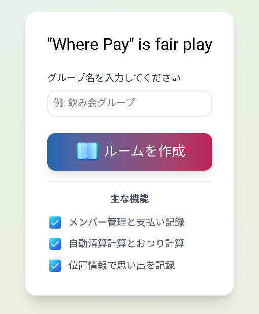
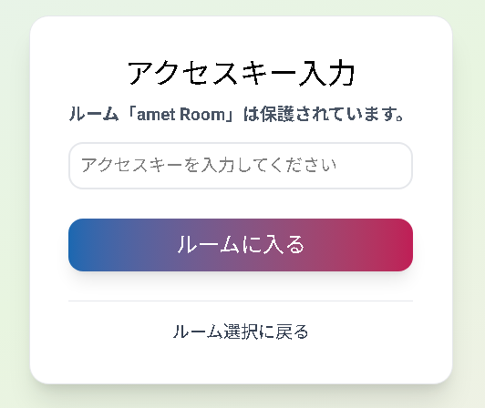
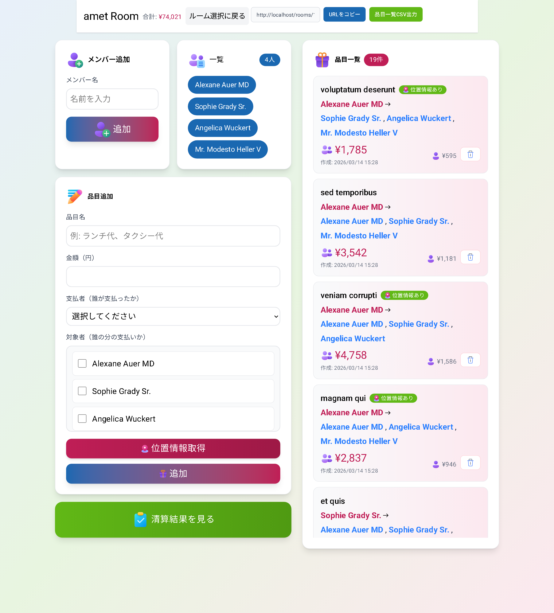
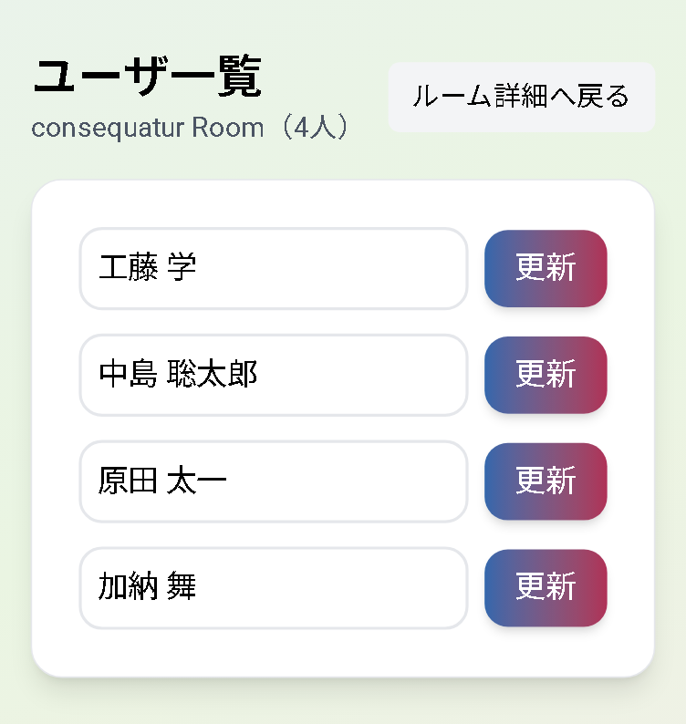
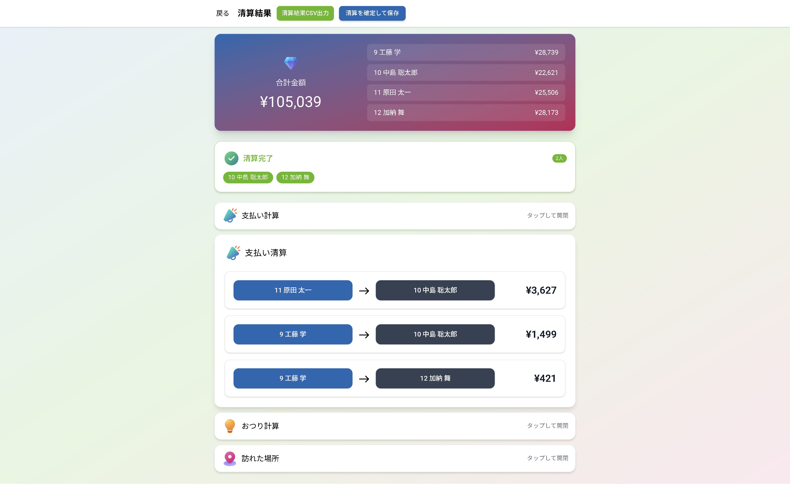
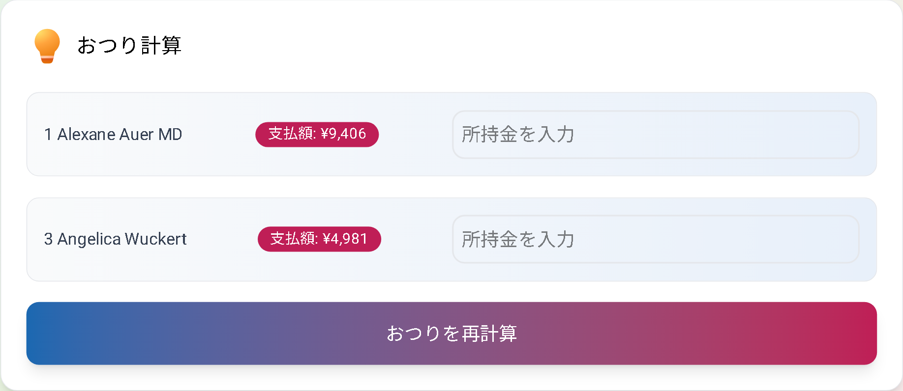
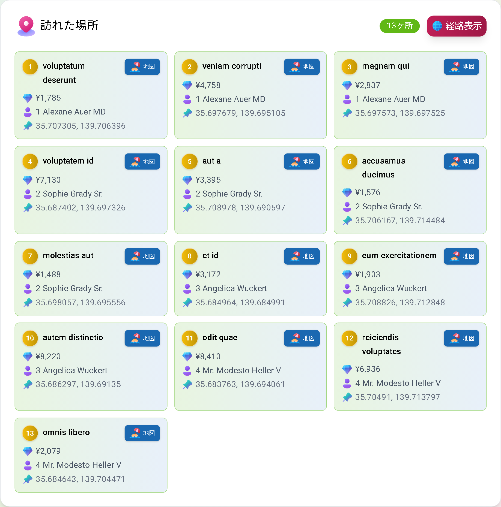

# 旅行・グループ活動 費用管理アプリ

旅行やイベントなどのグループ活動で発生する支出を、**「誰が・何に・いくら使ったか」** で記録し、最後に自動で清算できる Web アプリです。  
支出データには位置情報も紐づけられるため、費用管理だけでなく活動ログとしても活用できます。

---

## 目次

- [アプリ概要](#アプリ概要)
- [主な価値](#主な価値)
- [技術スタック](#技術スタック)
- [開発環境セットアップ](#開発環境セットアップ)
- [実行方法](#実行方法)
- [デプロイ](#デプロイ)
- [現在の実装機能](#現在の実装機能)
- [ER 図](#er-図)
- [スクリーンショット](#スクリーンショット)
- [ディレクトリ構成](#ディレクトリ構成)
- [利用上の注意](#利用上の注意)
- [今後の拡張アイデア](#今後の拡張アイデア)
- [ドキュメント目次](#ドキュメント目次)

---

## アプリ概要

このアプリケーションは、**旅行や一日イベントなどのグループ活動における「お金の管理」と「清算」を、位置情報と紐づけて行えるアプリ**です。

- 現地での立替をその場で登録
- 活動終了時に公平な支払い額を自動計算
- 支出履歴を場所と一緒に振り返り

計算やメモの手間を減らし、会計担当者だけに負担が偏らない運用を目指しています。

---

## 主な価値

- **その場でサッと支出登録**
  - 項目（交通費・食事・観光など）、金額、支払者、対象者をシンプルに入力
  - 位置情報を併せて保存し、支出の文脈を残せる
- **位置情報と一緒に思い出を可視化**
  - どこで何に使ったかを一覧で確認
  - 訪問順のルートを Google Maps で確認可能
- **最後はワンタップで清算**
  - 誰が誰にいくら支払うべきかを自動計算
  - おつり計算まで含めて現地で完結
- **インストール不要**
  - ブラウザのみで利用可能
  - スマホ / タブレット / PC から同一ルームに参加可能

---

## 技術スタック

- **バックエンド**
  - Laravel 12 (PHP 8.5)
  - Twig (`rcrowe/twigbridge`)
- **フロントエンド**
  - Vite
  - JavaScript
  - Tailwind CSS
- **補助ツール**
  - PHPUnit (テスト)
  - PHPStan / Larastan (静的解析)
  - Twig CS Fixer / Prettier (整形)
- **ホスティング**
  - Fly.io（設定の正本は `backend/fly.toml`）。手順は [デプロイ](#デプロイ)

`backend/` 配下に Laravel アプリを配置し、Vite によるアセットビルドを組み合わせる構成です。

---

## 開発環境セットアップ

### 前提

- PHP 8.5
- Composer
- Node.js / npm
- （任意）Docker（Laravel Sail で動かす場合）

### 初期構築（推奨・ローカルで動かす）

リポジトリルートから以下を実行します。

```bash
cd backend
composer run setup
```

`composer run setup` では以下が自動実行されます。

- 依存パッケージのインストール（Composer / npm）
- `.env` 作成
- アプリケーションキー生成
- マイグレーション実行
- フロントエンドビルド

#### DB について（ローカル実行）

このプロジェクトはデフォルトで SQLite を想定しています（`DB_CONNECTION=sqlite`）。

- **SQLite で動かす場合**: `backend/database/database.sqlite` が必要です（存在しない場合は作成してください）。

```bash
cd backend
mkdir -p database
touch database/database.sqlite
```

- **PostgreSQL 等で動かす場合**: `.env` の `DB_CONNECTION` / `DB_HOST` / `DB_DATABASE` などを合わせてください。

### Docker（Laravel Sail）で動かす（任意）

Docker を使う場合は `backend/compose.yaml`（Sail）を利用できます（PostgreSQL コンテナが起動します）。

```bash
cd backend
composer install
./vendor/bin/sail up -d
./vendor/bin/sail artisan migrate
./vendor/bin/sail npm install
./vendor/bin/sail npm run dev
```

---

## 実行方法

### 開発モード（推奨）

```bash
cd backend
composer run dev
```

起動内容:

- Laravel 開発サーバー
- キューリスナー
- ログ監視
- Vite 開発サーバー

補足:

- `php artisan serve` の既定ポートは **8000** です（環境により変更される場合があります）。
- Vite は既定で **5173** を使用します。

### テスト / 品質チェック

```bash
cd backend
composer run test
composer run phpstan
composer run twig:lint
composer run lint:lines
```

---

## デプロイ

本番の公開先は **Fly.io** です。ルーム・メンバー・支出・清算の作成、参照、更新、削除は SQLite に残します。接続先は Fly Volume `wherepay_data` 上の `/data/database.sqlite` です。

設定の正本は次のファイルです。環境変数の見本は [`backend/.env.deploy.example`](backend/.env.deploy.example) です。

- `backend/fly.toml` … アプリ名、リージョン、環境変数、HTTP、Volume、マシンサイズ
- `backend/Dockerfile` … PHP 8.5 と Vite ビルドを含む本番イメージ
- `backend/.fly/` … nginx / PHP-FPM / 起動時スクリプト

アプリ名は `wherepay-old-shape-6823`、リージョンは東京（`nrt`）、公開 URL は `https://wherepay-old-shape-6823.fly.dev` です。コマンドは、リポジトリの `backend/` で実行します。`fly.toml` がそこにあるためです。

### 公式ドキュメントの見方

Fly.io のドキュメントは英語だけです。Chrome でページを開き、右クリックの「日本語に翻訳」を使います。翻訳は機械翻訳なので、左の目次でページを決め、右側の番号付き手順と灰色のコード枠を追います。黄色や赤の枠は注意です。

このアプリで開くページは次のとおりです。検索欄に英語の見出しを入れても同じページに届きます。

| 目次の英語 | 開くページ | このアプリでの使い方 |
| --- | --- | --- |
| Getting Started | [Launch your app](https://fly.io/docs/getting-started/launch/) | `flyctl` の導入とログインの流れ |
| Language & Framework Guides | [Laravel on Fly.io](https://fly.io/docs/laravel/) | Laravel を載せるときの全体像。下記のとおり `fly launch` は使わない |
| Fly Volumes | [Add volume storage](https://fly.io/docs/launch/volume-storage/) | `/data` にディスクを付け、デプロイ後も SQLite を残す |
| Apps on Fly.io | [Secrets](https://fly.io/docs/apps/secrets/) | `APP_KEY` を暗号化して渡す |
| About | [Free Waiver](https://fly.io/docs/about/free-waiver/) | 月額請求が $5 未満なら、その月は支払わない |
| About | [Resource Pricing](https://fly.io/docs/about/pricing/) | マシン、Volume、リージョンごとの料金 |
| Reference | [Install flyctl](https://fly.io/docs/flyctl/install/) | Windows へのコマンドの入れ方 |

[Laravel on Fly.io](https://fly.io/docs/laravel/) の最初のコマンドは `fly launch` です。これは空の Laravel を新規に載せる手順で、Dockerfile と `fly.toml` を作り、Postgres や Redis を提案します。このリポジトリには設定がすでにあるので、公開と更新は `fly deploy` を使います。`fly launch` が上書きを聞いてきたときは No を選びます。

### 費用を $0 に保つ

Fly.io に無料枠はありません。公式の [Free Waiver](https://fly.io/docs/about/free-waiver/) では、申し込み時の個人組織（Personal）の月額請求が $5 未満なら全額免除されます。$5 以上の月は、先頭の $5 を引かずに請求額の全額を払います。免除には、その個人組織へクレジットカードを登録します。カードが無い間は、$1・7 日間のトライアルだけです。自分で追加した別の組織には免除がありません。

2026 年 11 月の [Resource Pricing](https://fly.io/docs/about/pricing/) では、料金は次のとおりです。東京の計算用の倍率は 1.308 です。

- 止まっているマシンは、CPU とメモリを課金しない。コンテナイメージの容量だけ（1GB あたり月 $0.15）
- Volume はマシンが止まっていても、確保した容量で課金する。1GB で月 $0.15
- `shared-cpu-1x` / 512MB を東京で 30 日起動し続けると、計算上およそ $4.83。これに Volume の $0.15 が乗る
- 31 日の月や外向き通信（アジアは 1GB あたり $0.04）が乗ると $5 を超え、その月は全額の請求になる

`fly.toml` の `min_machines_running = 0` を維持し、アクセスが無いときはマシンを止めます。旅行のときだけ開く使い方なら、免除の内側に収まります。専用 IPv4（月 $2）、Managed Postgres（月 $38 から）、マシンの追加は入れません。請求額は [ダッシュボード](https://fly.io/dashboard) の Billing で見ます。組織名が Personal であることを確認します。

### データが残る条件

支出と清算は Volume に残します。アクセスが途切れるとマシンは `stopped` になります。これは障害ではなく、次のアクセスで起動するまでの正常な状態です。Volume の中の SQLite は残るので、起動後に同じルームへ続きから書けます。最初の表示は、マシンが起きるまで待ちます。

起動時の `backend/.fly/scripts/migrate.sh` は、本番で `/data` がマウントされていなければプロセスを終了します。空のコンテナ内 DB に落ちて、記録が消えたように見えるのを防ぐためです。

Volume は 1 台のマシンにしか付きません。公式ページにある `fly machine clone` は、空のディスクがもう 1 台できるだけで、SQLite の中身はコピーしません。マシンは 1 台のままにします。

ディスクが消えるのは、ダッシュボードか `fly volumes destroy`、`fly apps destroy` で Volume やアプリ自体を削除したときです。`fly deploy` では消えません。

### 手順

#### 1. コマンドを入れる

PowerShell で、[Install flyctl](https://fly.io/docs/flyctl/install/) の Windows 用コマンドを実行します。

```powershell
powershell -Command "iwr https://fly.io/install.ps1 -useb | iex"
```

終わったら PowerShell を開き直し、`fly version` で版が表示されることを確認します。

#### 2. アカウント

ブラウザが開きます。すでにアカウントがあるときは `fly auth login` です。

```powershell
fly auth signup
```

登録後、[ダッシュボード](https://fly.io/dashboard) の個人組織にクレジットカードを登録します。

#### 3. 秘密の鍵を渡す

`APP_KEY` は `fly.toml` に書きません。[Secrets](https://fly.io/docs/apps/secrets/) の手順で渡します。`fly secrets list` は名前だけを表示し、値は見えません。

```powershell
cd backend
php artisan key:generate --show
fly secrets set 'APP_KEY=base64:ここに表示された値'
```

#### 4. ディスクを作って載せる

[Add volume storage](https://fly.io/docs/launch/volume-storage/) の、既存アプリに Volume を足す手順です。`[mounts]` は `fly.toml` にあります。東京に 1 個だけ作ります。

```powershell
fly volumes create wherepay_data -r nrt
fly deploy
```

`fly status` でアプリが無いと言われたら、`fly.toml` と同じ名前で作ってから、Volume の作成と `fly deploy` をやり直します。

```powershell
fly apps create wherepay-old-shape-6823
```

`fly deploy` の途中で Volume を作るか聞かれたら Yes と答えます。Postgres、Redis、Tigris を足すか聞かれたら No と答えます。

#### 5. データが残るか確認する

```powershell
fly apps open
```

ブラウザでルームを 1 つ作り、メンバーと支出を登録します。数分放置してからもう一度開きます。同じルームが残っていれば、Volume 上で作成・参照・更新・削除が成り立っています。

```powershell
fly status
fly volumes list
fly logs
```

`fly volumes list` の `REGION` が `nrt` で、`ATTACHED VM` にマシン ID が入っていれば、ディスクは接続されています。

2 回目以降の更新は、`backend/` で `fly deploy` だけです。

### 画面に出る英語

| 表示 | 意味 |
| --- | --- |
| Personal | 月額 $5 未満の免除が付く個人組織 |
| Do you want to tweak these settings before proceeding? | 提案された設定を変えるか。Postgres などが入っていたら Yes にして外す |
| Postgres / Redis / Tigris | 追加の有料サービス。このアプリでは追加しない |
| started | 起動中。この時間だけ CPU とメモリが課金対象 |
| stopped | 停止中。SQLite は Volume に残る |
| created | Volume はあるが、まだマシンに付いていない |

---

## 現在の実装機能

### 1) ルーム作成画面（`/`）

- グループ名入力によるルーム作成
- 入力バリデーションエラー表示

### 2) アクセスキー入力画面（`/rooms/{room}` ※キー不一致時）

- `query_key` を入力してルームへ入室
- ルーム選択（作成）画面へ戻る

### 3) ルーム詳細画面（`/rooms/{room}?query_key=...`）

- メンバー追加・メンバー一覧表示（人数表示つき）
- 品目追加（品目名、金額、支払者、対象者[複数選択]、位置情報取得）
- 品目一覧表示（品目名、支払者、対象者、金額、作成日時、1人あたり金額、位置情報ありバッジ）
- 品目削除
- ルーム URL 表示・コピー
- 品目一覧 CSV 出力
- 清算結果画面への遷移（条件: メンバー・品目が存在）
- 支払いランキング表示（開閉式）

### 4) 清算結果画面（`/rooms/{room}/settlement?query_key=...`）

- 清算サマリー表示（合計金額・メンバー別負担）
- 支払い計算結果表示（誰が誰にいくら払うか）
- おつり計算（メンバー別所持金入力、不足/おつり表示、清算完了判定）
- 清算完了メンバー一覧表示
- 全員完了時の「清算完了」表示
- 訪れた場所一覧表示（各地点の地図リンク、全体経路表示リンク）
- 清算結果 CSV 出力
- 清算を確定して保存（`Settlement` レコード作成）
- ルーム詳細へ戻る

---

## ER 図

主要テーブルとリレーションの概要です。編集可能な Mermaid ソースは [doc/er.md](doc/er.md) にあります。



`doc/image/er.svg` を [Kroki](https://kroki.io) で再生成する例（リポジトリルート・ネットワーク必須）:

~~~bash
awk '/^```mermaid$/,/^```$/' doc/er.md | sed '1d;$d' | curl -sS -o doc/image/er.svg -X POST https://kroki.io/mermaid/svg -H "Content-Type: text/plain" --data-binary @-
~~~

各画面の見た目は [スクリーンショット](#スクリーンショット) を参照してください。

---

## スクリーンショット

[アプリの進行（画面遷移）](doc/workflow.md) と同じ流れで、主要画面のキャプチャです。

### トップページ（ルーム作成）

ルーム名を入力してグループ用のルームを新規作成します。



### セキュリティページ（アクセスキー入力）

`query_key` が無い／不一致のときに表示され、正しいキーで入室します。



### 登録ページ（ルーム詳細）

メンバー・支出品目の登録、URL 共有、清算への遷移などを行います。



### メンバー一覧（編集）ページ

登録済みメンバーの一覧と名前の更新ができます。



### 品目一覧（編集）ページ

品目名・対象者・位置情報の更新や削除ができます（金額・支払者は変更不可）。


### 清算ページ

合計・負担額・支払い関係のサマリーを表示します。



### おつり計算

所持金入力と清算完了の判定を行います。



### 訪れた場所

品目に紐づいた位置の一覧と、Google Maps へのルートリンクがあります。



---

## ディレクトリ構成

```text
app_portfolio/
├── README.md
├── backend/       # Laravel 本体
│   ├── app/
│   ├── resources/views/   # Twig テンプレート
│   ├── routes/
│   ├── database/
│   └── ...
└── doc/           # 画面遷移や画像ドキュメント
    ├── workflow.md
    └── image/
```

---

## 利用上の注意

- 位置情報を使う機能では、ブラウザ側で位置情報利用の許可が必要です。
- ルーム参加には `query_key` が必要です。URL 共有時は取り扱いに注意してください。
- 支出項目（品目）は、品目編集ページで **一部の編集** ができます（品目名・対象者・位置情報）。
- ただし **金額・支払者は編集できません**（必要に応じて削除して再登録で対応）。
- 「訪れた場所」の地図リンクは Google Maps（URL）を利用しています。

---

## 今後の拡張アイデア

- 履歴検索 / 集計ビュー（カテゴリ別・日別）

---

## ドキュメント目次

### 概要・機能一覧

- [README（このページ）](README.md)
- [デプロイ](#デプロイ)
- [アプリの進行](doc/workflow.md)
- [ER 図](doc/er.md)

### 画面別ガイド（workflow）

画面キャプチャは [スクリーンショット](#スクリーンショット) を参照してください。

- [トップページ](doc/workflow.md#トップページ)
- [セキュリティページ](doc/workflow.md#セキュリティページ)
- [登録ページ](doc/workflow.md#登録ページ)
- [メンバー一覧（編集）ページ](doc/workflow.md#メンバー一覧編集ページ)
- [品目一覧（編集）ページ](doc/workflow.md#品目一覧編集ページ)
- [清算ページ](doc/workflow.md#清算ページ)
  - [支払い清算](doc/workflow.md#支払い清算)
  - [おつり計算](doc/workflow.md#おつり計算)
  - [訪れた場所](doc/workflow.md#訪れた場所)
